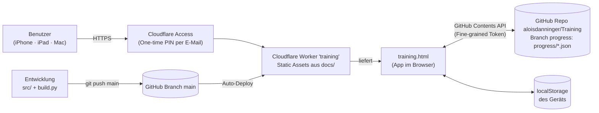
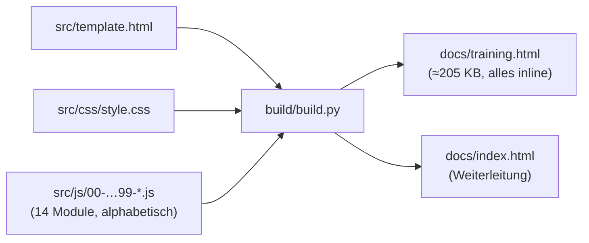
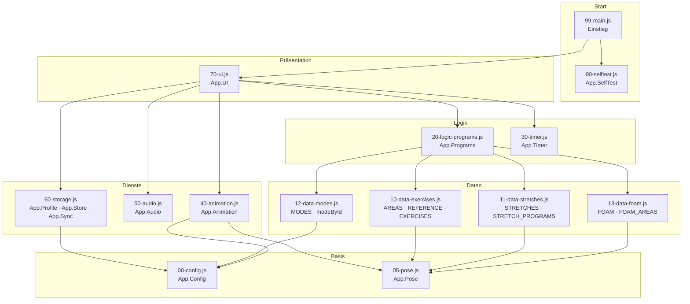
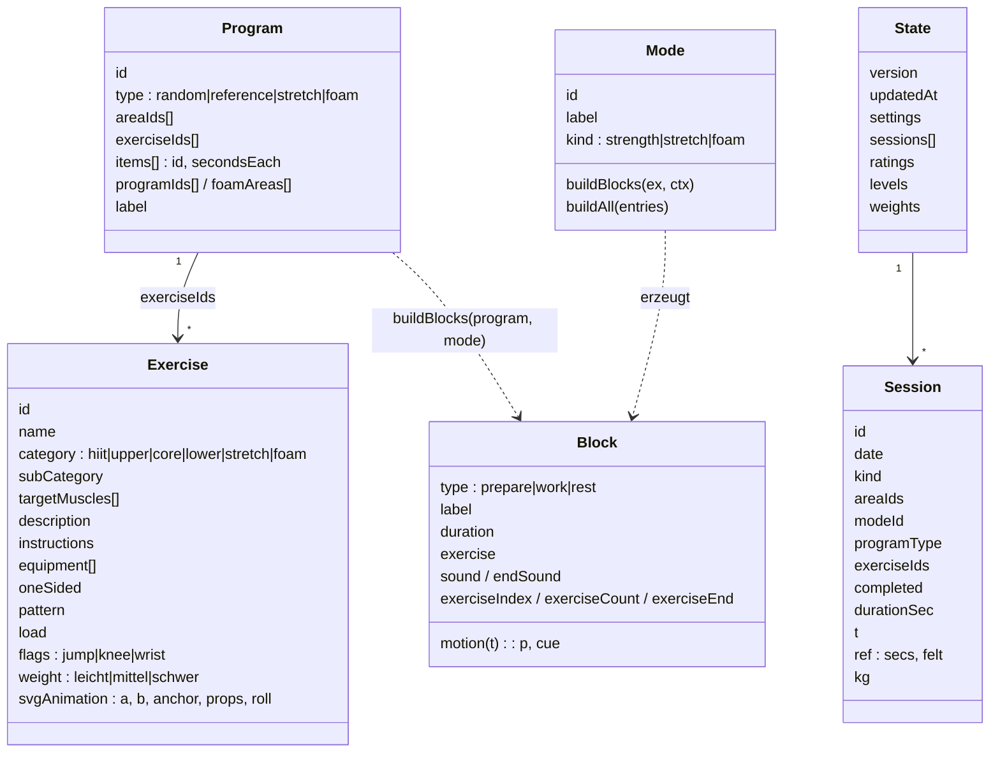
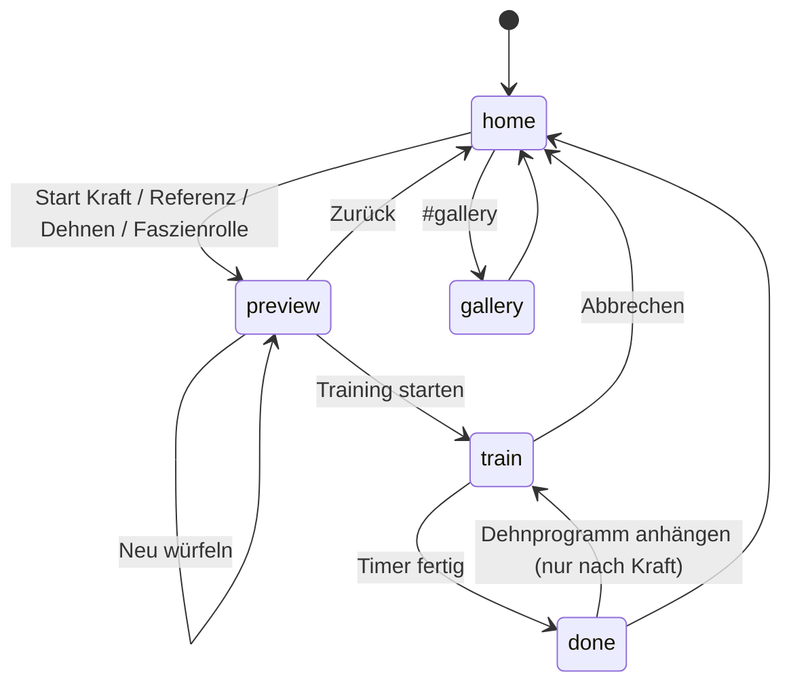
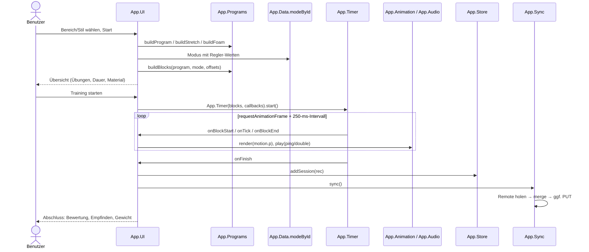
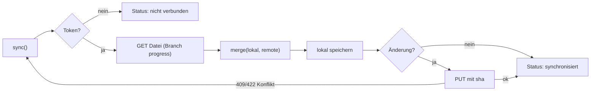

# Software-Architektur – Persönlicher Trainingsgenerator

Stand: 24.11.2026 · Commit-Basis `caf460d`

Dieses Dokument beschreibt, wie die App aufgebaut ist: Systemkontext, Build und Deployment, Module, Datenmodell, Abläufe zur Laufzeit, Persistenz und Synchronisation, Tests und Erweiterungspunkte.

---

## 1. Zweck und Rahmenbedingungen

Die App erstellt **persönliche Trainingsprogramme** und führt mit Timer, animierter Strichfigur und Signaltönen durch das Training. Sie deckt vier Programmarten ab:

| Programmart | Inhalt |
|---|---|
| Krafttraining | Bereiche HIIT, Ganzkörper, Oberkörper, Rumpf, Unterkörper; Stile Kieser, Klassisch, Zirkel; Zufalls- oder Referenzprogramm |
| Dehnen / Mobilität | 6 Dehnprogramme, Mehrfachauswahl, verbunden zu einem Programm |
| Faszienrolle | 14 Übungen, Bereiche Ganzkörper, Oberkörper, Rumpf, Unterkörper |
| Referenztraining | 12 feste Übungen, alle 30 Tage, mit Vergleich zum letzten Mal |

**Architekturtreiber**

- **Eine einzige HTML-Datei**, ohne Frameworks und ohne Server-Logik. Sie läuft offline auf Mac, iPad und iPhone, auch als Home-Bildschirm-App.
- **Keine Abhängigkeiten**: Vanilla-JavaScript, SVG, WebAudio und localStorage.
- **Gerätübergreifender Fortschritt ohne eigenes Backend**: JSON-Datei in einem GitHub-Repo, Zugriff über die GitHub Contents API.
- **Mehrere Benutzer** (Profile) auf denselben oder verschiedenen Geräten.
- **Testbarkeit**: Die Logik ist vom DOM getrennt, und ein eingebauter Selbsttest läuft im Browser.

---

## 2. Systemkontext

| Element | Rolle |
|---|---|
| Branch `main` | Quellcode (`src/`), Build-Skript, gebaute App (`docs/`) |
| Branch `progress` | Nur Fortschrittsdaten, eine JSON-Datei je Profil |
| Cloudflare Worker | Liefert `docs/` als statische Dateien aus (`wrangler.jsonc`) und deployt bei jedem Push auf `main` |
| Cloudflare Access | Zugriffsschutz vor der App |
| localStorage | Primärer Speicher je Gerät; die App funktioniert auch ohne Sync |

---

## 3. Build und Deployment

- `python -I build/build.py` fügt CSS und JS an den Markern `/*{{CSS}}*/` und `/*{{JS}}*/` ein.
- Die **Ladereihenfolge ergibt sich aus dem Dateinamen** (Präfix `00-` bis `99-`). Abhängigkeiten zeigen deshalb nur auf Module mit kleinerer Nummer.
- Der Build bricht ab, wenn ein Modul die Zeichenfolge `</script>` enthält.
- Ablauf einer Änderung: Build → Selbsttest (`#selftest` → Titel `SELFTEST PASS`) → Commit → Push auf `main` → Cloudflare deployt automatisch.

---

## 4. Modulstruktur

Alle Module hängen sich an den globalen Namespace `App`. Jedes Modul ist eine IIFE (*Immediately Invoked Function Expression*) mit einer kleinen öffentlichen Schnittstelle.

| Modul | Schicht | Verantwortung | Wichtige Schnittstelle |
|---|---|---|---|
| `00-config.js` | Basis | Namespace `App`, alle Parameter: Sync-Ziel, Material, Gewichte, Regler-Bereiche, Körpermaße, Bühne | `App.Config` |
| `05-pose.js` | Basis | Pose-Modell der Strichfigur mit absoluten Winkeln und Vorwärtskinematik | `App.Pose.P()`, `resolve()` |
| `10-data-exercises.js` | Daten | 111 Kraft- und HIIT-Übungen (je eine Zeile), Bereiche mit Slot-Regeln, Referenzliste, abgeleitete Attribute (Muster, Last, Flags, Gewichtsklasse, einseitig) | `App.Data.EXERCISES`, `AREAS`, `REFERENCE`, `byId`, `register()` |
| `11-data-stretches.js` | Daten | 35 Dehn- und Mobilitätsübungen, 6 Dehnprogramme | `STRETCHES`, `STRETCH_PROGRAMS` |
| `12-data-modes.js` | Daten | Trainingsstile: Zerlegung einer Übung in zeitliche Blöcke, Bewegungsfunktionen | `MODES`, `modeById(id, settings)` |
| `13-data-foam.js` | Daten | 14 Faszienrollen-Übungen, Bereichsdefinitionen | `FOAM`, `FOAM_AREAS` |
| `20-logic-programs.js` | Logik | Programmgenerierung, Rahmenbedingungen, Blockliste, Gesamtdauer, Materialübersicht, Gewichtsoptionen; kein DOM | `buildProgram`, `buildStretch`, `buildFoam`, `buildBlocks`, `totalSeconds`, `allowed`, `kgOptions` |
| `30-timer.js` | Logik | Zeitstempelbasierter Block-Timer; kennt weder DOM noch Übungen | `App.Timer(blocks, callbacks)` |
| `40-animation.js` | Dienst | SVG-Player: Figur zwischen zwei Posen interpolieren, Verankerung (Fuß, frei, Rolle), Requisiten | `createPlayer(svg)` → `setExercise`, `render(p)` |
| `50-audio.js` | Dienst | Signaltöne per WebAudio (ohne Audiodateien), iOS-Entsperrung, Mischen mit Musik | `play(name)`, `unlock()`, `setEnabled`, `setVolume` |
| `60-storage.js` | Dienst | Profile, lokaler Zustand, Merge, GitHub-Sync, Export/Import | `App.Profile`, `App.Store`, `App.Sync` |
| `70-ui.js` | Präsentation | Bildschirme Start, Übersicht, Training, Abschluss, Katalog, Overlay; Ereignisse | `App.UI.init()` |
| `90-selftest.js` | Test | 65 Prüfungen über Daten, Regeln, Timer, Animation und Sync-Pfade | `App.SelfTest.run()` |
| `99-main.js` | Start | Initialisierung bei `DOMContentLoaded`, Selbsttest bei `#selftest` | – |

**Abhängigkeitsregeln**

- Daten-Module enthalten nur Daten und kleine Hilfsfunktionen.
- Logik-Module greifen nicht auf das DOM zu und sind deshalb direkt im Selbsttest prüfbar.
- Nur `70-ui.js` greift auf das DOM zu, mit Ausnahme des Players in `40-animation.js`, der nur sein SVG-Element zeichnet.

---

## 5. Datenmodell

| Objekt | Herkunft | Lebensdauer |
|---|---|---|
| Exercise | Statische Daten (`10-` bis `13-`), registriert in `App.Data.byId` | Fest im Code |
| Program | `App.Programs.build*()` | Bis zum Trainingsende |
| Mode | `App.Data.modeById(id, settings)` mit den Regler-Werten | Pro Training |
| Block | `buildBlocks(program, mode, offsets, hiitMode)` | Pro Training (Timer-Eingabe) |
| Session | `finish()` in der UI, wenn mindestens eine Übung fertig ist | Dauerhaft (Store + Sync) |
| State | `App.Store`, ein Objekt je Profil | Dauerhaft |

**Anpassungen je Übung im State**

- `ratings[id]` = 1–5 Sterne. Beeinflusst, wie oft der Zufallsgenerator die Übung wählt.
- `levels[id]` = `{offset, last, t}`. Die Bewertung „zu leicht/zu schwer“ verlängert oder verkürzt die Übungszeit um ±5 s, höchstens ±60 s.
- `weights[id]` = `{kg, t}`. Das zuletzt verwendete Gewicht ist am Trainingsende vorgewählt. Die Auswahl kommt aus `Config.kg`: Kurzhanteln 1–4 kg, Kettlebell 8/10/12/16 kg.

---

## 6. Ablauf zur Laufzeit

### 6.1 Bildschirme

### 6.2 Ein Training von Anfang bis Ende

**Wichtige Eigenschaften des Timers**

- Er rechnet mit **Zeitstempeln** statt mit Ticks und bleibt deshalb korrekt, wenn der Browser im Hintergrund drosselt.
- `advance(dt)` ist die einzige Kernlogik. Der Selbsttest ruft sie direkt auf.
- Zwei Antriebe laufen parallel: `requestAnimationFrame` für flüssige Animation und ein 250-ms-Intervall als Rückfallebene.
- Während des Trainings hält die Wake-Lock-API den Bildschirm an.

**Signaltöne**

| Ton | Anlass |
|---|---|
| Doppelping | Start und Ende einer Übung bzw. eines Satzes; Seitenwechsel in der Mitte einseitiger Übungen |
| Einfacher Ping | 60, 30, 10, 3, 2 und 1 s Restzeit |
| Fanfare | Trainingsende |

---

## 7. Programmgenerierung (`20-logic-programs.js`)

### 7.1 Krafttraining (Zufall)

- **Reihenfolge der Bereiche** ist fest: HIIT → Ganzkörper → Oberkörper → Rumpf → Unterkörper.
- **Slot-Regeln** je Bereich (`AREAS[].slots`), Beispiel Oberkörper: 2 × Drücken, 1 × Ziehen, 1 × Schulter, 1 × Arme. Ganzkörper wählt Slots nach Bewegungsmustern (Kniebeuge/Ausfallschritt, Drücken, Hüftbeuge …).
- **Gewichtete Zufallsauswahl** (`pickWeighted`). Das Gewicht einer Übung ist das Produkt aus:
  - Sternebewertung: 1★ ×0,25 bis 5★ ×3
  - kürzlich trainiert (letzte 3 Sessions): ×0,25
  - gleiches Bewegungsmuster schon gewählt: ×0,3
  - vorhandenes Gewicht nutzbar: ×1,5
- **Rahmenbedingungen** (`allowed`): ohne Springen, knieschonend, handgelenkschonend, vorhandenes Material. Übungen mit befestigtem Band sind ausgeschlossen.
- Wenn ein Slot zu wenige Übungen hat, wird aus dem ganzen Bereich aufgefüllt. Keine Übung kommt doppelt vor.
- **HIIT** läuft immer zuerst im HIIT-Intervall. Danach folgt der Kraftteil im gewählten Stil (`buildBlocks` teilt das Programm auf).

### 7.2 Referenztraining

- 12 feste Übungen (`REFERENCE`), immer Kieser 90 s plus persönliche Anpassung.
- Die Session speichert Belastungszeit und Empfinden je Übung.
- Der Abschlussbildschirm vergleicht mit dem letzten Referenztraining.

### 7.3 Dehnen

- Mehrere Programme werden verbunden. Gemeinsame Übungen kommen nur einmal vor.
- Innerhalb eines Programms ist die Reihenfolge zufällig. Programme mit `pick` (Mobilität) ziehen nur 6 Übungen aus einem größeren Pool.
- Nach einem Krafttraining schlägt `stretchForAreas` das passende Dehnprogramm vor.

### 7.4 Faszienrolle

- `FOAM_AREAS[].from` legt die Anzahl je Körperbereich fest: Ganzkörper = je 2 aus Unterkörper, Rumpf und Oberkörper; ein Einzelbereich = bis zu 5.
- Bei Mehrfachauswahl gilt je Körperbereich der höchste Wert.
- Reihenfolge immer Unterkörper → Rumpf → Oberkörper, innerhalb der Bereiche zufällig.

### 7.5 Trainingsstile (`12-data-modes.js`)

| Stil | Bauart | Ablauf |
|---|---|---|
| Kieser | `buildBlocks` | Vorbereitung, dann 60–120 s im Zyklus 4 s Belastung · 2 s halten · 4 s zurück · 2 s halten |
| Klassisch | `buildBlocks` | Sätze × Sekunden mit 10 s Pause dazwischen |
| Zirkel | `buildAll` | Runden über alle Übungen, Wechselzeit, Rundenpause |
| HIIT | `buildBlocks` | Belastung/Pause/Runden über Regler, 60 s Rundenpause, Bewegungstakt 2 s |
| Dehnen | `buildBlocks` | 12 s Vorbereitung, 9 s in die Dehnung gleiten, dann halten (Mobilität: Wiederholung alle 6 s) |
| Faszienrolle | `buildBlocks` | 12 s Vorbereitung; 60 s, einseitig 90 s; im 30-s-Zyklus 24 s rollen, 6 s Druckpunkt halten |

Jeder Block liefert `motion(t)` → `{p, cue}`. Dabei ist `p` (0…1) der Fortschritt der Bewegung für die Animation und `cue` der angezeigte Phasentext.

---

## 8. Animation (`05-pose.js`, `40-animation.js`)

- **Pose** = absolute Winkel für Rumpf, Kopf, vorderen und hinteren Arm sowie vorderes und hinteres Bein (0° = oben, 90° = Blickrichtung, 180° = unten), dazu optional eine Höhenverschiebung `y`.
- Jede Übung hat eine **Startpose `a`** und eine **Endpose `b`**. Der Player interpoliert linear mit `p` aus dem aktuellen Block.
- Die **Verankerung** bestimmt, welcher Punkt der Figur am Boden bleibt:

  | Anker | Verhalten |
  |---|---|
  | `foot` (Standard) | Der Fuß bleibt stehen |
  | `free` | Der tiefste Punkt liegt auf dem Boden (Liegen, Stütz) |
  | `roller` | Ein Körpersegment liegt auf der Faszienrolle; die Kontaktstelle wandert entlang `roll.f` und die Rolle dreht sich mit |

- Ansichten: seitlich (Standard) oder frontal (`view: 'front'`) für seitliche Bewegungen.
- Requisiten: Kettlebell, Stange, Faszienrolle.
- Körpermaße und Bühne kommen aus `Config.body` und `Config.stage` (240×200, Boden bei y = 172).

---

## 9. Persistenz, Profile und Synchronisation (`60-storage.js`)

### 9.1 Speicherorte

| Daten | Ort | Synchronisiert |
|---|---|---|
| Zustand je Profil (Einstellungen, Sessions, Bewertungen, Stufen, Gewichte) | localStorage `training-state-v1[-p-<profil>]` | ja |
| Gewähltes Profil | localStorage `training-profile` | nein (pro Gerät) |
| GitHub-Token | localStorage `training-gh-token` | nein (pro Gerät) |
| Ton an/aus, Lautstärke | localStorage `…-sound`, `…-vol` | nein (pro Gerät) |
| Beschreibung eingeklappt | localStorage `training-info-collapsed` | nein (pro Gerät) |

### 9.2 Profile

| Profil | Lokaler Schlüssel | Sync-Datei auf Branch `progress` |
|---|---|---|
| Lois (Standard, auch ohne Auswahl) | `training-state-v1` | `progress/training-lois.json` |
| Elke (und jedes weitere Profil) | `training-state-v1-p-elke` | `progress/training-elke.json` |
| Test | `training-state-v1-p-test` | `progress/training.json` |

Ein Profilwechsel lädt die Seite neu, damit `App.Store` den passenden Zustand lädt.

### 9.3 Sync-Ablauf und Merge-Regeln

**Auslöser:** App-Start, Rückkehr in den Vordergrund (nur auf der Startseite), Trainingsende, Sync-Knopf.

**Merge-Regeln (`App.Store.merge`)**

| Daten | Regel |
|---|---|
| Sessions | Vereinigung per `id`, es geht nichts verloren. Bei gleicher `id` gewinnt die später geänderte (`t`). |
| `levels`, `weights` | Je Übung gewinnt der jüngere Eintrag |
| `ratings` | Je Übung gewinnt der Wert aus dem neueren Gesamtstand; Bewertungen, die nur im älteren Stand vorkommen, bleiben erhalten |
| `settings` | Der Stand mit dem neueren `updatedAt` gewinnt |

> **Folge:** Gelöschte Sessions kommen über den Merge zurück, solange ein Gerät sie noch lokal hat. Deshalb gibt es das Profil „Test“ für Versuche. Echte Daten in einer Sync-Datei bereinigt man nur zusammen mit dem lokalen Stand aller Geräte.

Zusätzlich gibt es Export und Import als JSON-Datei. Der Import wird ebenfalls gemergt.

---

## 10. Qualitätssicherung

- **Selbsttest** `training.html#selftest`: 65 Prüfungen, Ergebnis im Seitentitel (`SELFTEST PASS` / `SELFTEST FAIL (…)`). Abgedeckt sind:
  - Datenkonsistenz (Anzahlen, Referenzen, Pflichtfelder)
  - Generator-Regeln (Slots, keine Doppelten, Rahmenbedingungen, Gewichtung)
  - Dehn- und Faszienrollen-Programme
  - Stile und Dauern, Timer-Übergänge
  - Gewichtsoptionen, Bewertung und Stufen
  - Profil-Sync-Pfade
  - Posen: Figur bleibt auf dem Boden bzw. auf der Rolle
- **Headless-Ausführung** über Edge (`--headless --dump-dom …#selftest`).
- **Sichtprüfung der Animationen**: Katalog unter `training.html#gallery`; in der Entwicklung zusätzlich Einzelbilder mehrerer Bewegungsphasen per Headless-Screenshot.

---

## 11. Erweiterungspunkte

| Vorhaben | Wo |
|---|---|
| Neue Kraftübung | Eine Zeile in `EXERCISE_ROWS` (`10-data-exercises.js`); bei Bedarf in `WEIGHT`, `ONE_SIDED`, `MAT` und Muster-/Flag-Tabellen ergänzen |
| Neue Dehnübung / neues Dehnprogramm | `11-data-stretches.js` (`STRETCHES`, `STRETCH_PROGRAMS`) |
| Neue Faszienrollen-Übung / neuer Bereich | `13-data-foam.js` (`FOAM`, `FOAM_AREAS`) |
| Neuer Trainingsstil | Eintrag in `MODES`, Zweig in `modeById`, Regler in `Config` und `STYLE_OPTS` (UI) |
| Neues eigenständiges Programm (wie Faszienrolle) | Daten-Modul `1x-data-*.js` mit `App.Data.register`, Builder in `App.Programs`, Modus in `MODES`, Abschnitt in `template.html`, Startlogik und Neu-Würfeln in `70-ui.js`, Prüfungen in `90-selftest.js` |
| Material oder Gewichte | `Config.gear`, `Config.gearLabel`, `Config.kg`; Zuordnung Text → Material in `GEAR` / `CANON` |
| Neuer Animationsanker oder neues Requisit | `40-animation.js` (`offsetFor`, `buildProps`) |

---

## 12. Architekturentscheidungen

| Entscheidung | Begründung | Konsequenz |
|---|---|---|
| Eine HTML-Datei als Auslieferung, modulare Quellen | Offline-fähig, einfach zu hosten und zu kopieren; trotzdem wartbar | Build-Schritt nötig; die Ladereihenfolge ergibt sich aus den Dateinamen |
| Kein Framework, keine Bibliotheken | Keine Abhängigkeiten, die veralten; kleine Datei | UI-Code mit direkter DOM-Manipulation |
| GitHub als Speicher statt eigenem Backend | Kostenlos, versioniert, kein Serverbetrieb | Token je Gerät; Konflikte werden über `sha` und Wiederholung gelöst |
| Merge statt „letzter gewinnt“ für Sessions | Offline-Training auf mehreren Geräten ohne Datenverlust | Löschen ist nicht zuverlässig möglich → Testprofil |
| Profile mit eigener Datei | Getrennte Daten je Person, keine Vermischung | Profil wird pro Gerät gewählt |
| Zeitstempelbasierter Timer, getrennt vom DOM | Korrekt bei Hintergrund-Drosselung; testbar | – |
| Prozedurale Strichfigur statt Videos/Bilder | Klein, einheitlicher Stil, jede Übung mit zwei Posen beschreibbar | Komplexe Bewegungen nur vereinfacht darstellbar |
| WebAudio-Töne statt Audiodateien | Keine Dateien; Mischen mit Musik auf iOS (`ambient`) | iOS braucht eine Nutzergeste zum Entsperren |
| Eingebauter Selbsttest im Produkt | Läuft auf jedem Gerät und headless ohne Testinfrastruktur | Testcode wird mit ausgeliefert (gering) |
